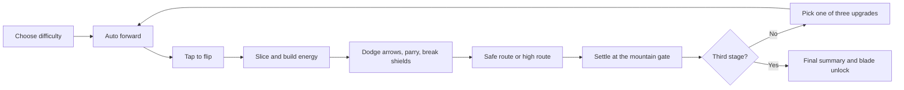
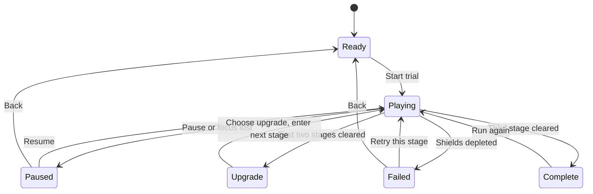

**English** | [简体中文](game-design.zh-CN.md)

# Bladebound game design document

Project name (English) Bladebound  
Version 0.2  
Date 4 November 2026  
Project type Browser side-scrolling action casual game  
Document status Design as implemented by the playable prototype

## Contents

- [1 Product definition](#1-product-definition)
- [2 Core loop and controls](#2-core-loop-and-controls)
- [3 Combat and resources](#3-combat-and-resources)
- [4 Stages and content](#4-stages-and-content)
- [5 Upgrades and long-term unlocks](#5-upgrades-and-long-term-unlocks)
- [6 State and interface](#6-state-and-interface)
- [7 Numbers at a glance](#7-numbers-at-a-glance)
- [8 Art and sound](#8-art-and-sound)
- [9 Technology and saving](#9-technology-and-saving)
- [10 Acceptance and iteration](#10-acceptance-and-iteration)

## 1 Product definition

### 1.1 One-sentence definition

The player steers a self-propelling flying blade, flips it with a single tap, and times continuous slicing, arrow dodging, and shield breaking across three stretches of mountain country, choosing an upgrade between stages.

The game's identifying idea is that slicing and combat share one input and one resource: slicing objects builds energy, and at full energy the next hit on an enemy releases a charged slash. Fruit placement, enemy positions, and hazards together decide the player's order of action.

### 1.2 Product goals

| Item | Goal |
| --- | --- |
| Platform | Modern desktop and mobile browsers |
| Primary audience | Casual action players who like short runs, a low input barrier, and instant feedback |
| Single full run | Three stages, usually about 2.5 to 4 minutes; retries and upgrade deliberation extend it |
| First-experience goal | One deliberate press produces a clear flip; the first slice gives immediate feedback |
| Core mastery goal | Chain slices for energy, dodge attacks, then spend the charged slash on shielded or heavy targets |
| Replay motivation | Higher scores, different routes and upgrade pairings, cosmetic unlocks |
| Primary input | Pointer or touch press, with Space as an equivalent keyboard action |
| First-release payment and ads | No real payments, no ad SDK, no account requirement |

The current duration is an estimate derived from path length and speed, not a measured median from a player sample.

### 1.3 Reference relationships

| Reference game | Design idea absorbed | Adjustment in Bladebound |
| --- | --- | --- |
| Slice Master | Single-button blade flipping, continuous slicing, forward progress | Slicing also feeds combat energy, with enemies and route choices added |
| Space Waves | Obstacle telegraphing, rhythm-based trajectory adjustment, fast retry | Unified into tap-to-flip; ordinary mistakes are absorbed by shields |
| Ragdoll Archers | Arrow threats, physical hit feedback, growth decisions | Enemies fire automatically and the player counters with the blade edge; growth is mostly in-run upgrades |

This project's code, stages, numbers, and SVG art are independent prototype content. The original technical teardown document is kept in ../crazygames, and this project does not treat its reproduction suggestions as the reference games' actual values.

### 1.4 First-release scope

| System | Prototype 0.2 |
| --- | --- |
| Core movement and flipping | Built on Matter.js fixed-step physics |
| Slicing and combos | Implemented; each object settles once |
| Charged slash, shield break, arrow parry | Implemented |
| Enemies | Regular archer, shielded archer, heavy archer, one boss |
| Ragdolls | Jointed rigid bodies spawn on defeat; living enemies use fixed poses and attack telegraphs |
| Content | Three stages, 12 standalone segments, one high route per stage |
| Checkpoints | One travel lantern at the midpoint of each stage |
| In-run upgrades | Six upgrades, two between-stage choice points |
| Long-term unlocks | Six blade and trail colour schemes sharing one set of collision and movement parameters |
| Interface | Standard and relaxed difficulty, pause, retry, summary, blade vault, journal, settings |
| Saving | Local browser save |
| Language | English by default, English and Simplified Chinese, switchable on the start screen and in settings |
| Follow-up scope | More stages, full living-body physics, authored sound sources, platform SDK and player analytics |

## 2 Core loop and controls

### 2.1 Single-run loop



### 2.2 Input rules

| Input | Behaviour |
| --- | --- |
| Mouse or touch press inside the game view | Performs one flip |
| Flip button in the control bar | Same flip action |
| Space press | Same flip action, keyboard repeat ignored |
| P or Escape | Toggles between running and paused |
| Escape inside a dialog | Closes the current dialog |
| Page loses visibility or window focus | Auto-pause, except in the manual-clock mode used by background tests |

Input triggers on the rising edge; holding does not repeat. The minimum effective interval is 0.09 seconds. Flipping again in the air is allowed and resets vertical speed to the jump speed, so tap rhythm controls height.

The same button carries both movement and attack decisions: attacks trigger on blade-edge contact, with no separate attack key and no mobile virtual stick.

### 2.3 Movement model

World coordinates follow the browser canvas convention, x to the right and y downward; length is in logical pixels (px) and time in seconds. Screen scaling changes neither world units nor physics results.

| Parameter | Value |
| --- | --- |
| Standard forward speed | 220 px/s |
| Relaxed forward speed | 188 px/s |
| Jump vertical speed | -610 px/s |
| Theoretical vertical acceleration | About 1350 px/s², from Matter.js gravity.y=1.35 |
| Rotation speed after a flip | 10.5 rad/s for 0.9 seconds |
| Idle rotation speed | 1.65 rad/s |
| Highest position | Blade centre y never above 90 |
| Blade physics size | 78 × 12 px |
| Main ground height | y=492 |

For an ideal model of one free jump with no collision and no second input, apex time is about 0.452 seconds, rise about 137.8 px, and the return to the same height takes about 0.904 seconds. At standard speed the horizontal distance is about 198.8 px. Blade rotation and ground contact affect the real trajectory, so these theoretical figures serve only as an initial check on level layout.

The prototype uses a rotating rectangular physics body. Blade orientation on landing affects contact feedback but cannot change the forward-speed difficulty tier. Blade appearance does not adjust these base movement parameters.

### 2.4 Camera and layout

The camera follows the blade horizontally and provides look-ahead space. Desktop shows a wider scene; mobile keeps at least about 760 logical units of horizontal framing and uses scene whitespace to fit portrait screens.

The blade usually sits at about 20% of the viewport width. World positions update on the fixed physics step and the view is drawn from requestAnimationFrame. Resizing the window only adjusts projection scale and camera position; it does not restart the stage.

## 3 Combat and resources

### 3.1 Resources

| Resource | Source | Spent on or used for | Persistence |
| --- | --- | --- | --- |
| Shields | Start, between-stage recovery, Jade Armour, Restoration | Arrow hits, spike contact, falls | This run |
| Slash energy | Slicing, arrow parries, Blade Gathering | Cleared when a full-energy hit lands on an enemy | This run, carried between stages |
| Score | Slicing, kills, arrow parries, high routes | Never spent; converted to coins at stage entry | Accumulates within a run; best record is permanent |
| Coins | Settled on each stage completion | Unlocking blade colours | Permanently saved locally |
| Combo count | Consecutive slices | Broken by timeout or damage | Temporary |

### 3.2 Slicing

Sliceable objects are red fruit, green pears, and wooden crates. All three are worth the same in the prototype; they differ mainly in visuals, size, and debris. Higher-value but harder-to-reach objects could be added later.

The blade edge samples three line segments — previous frame, mid pose, and current frame — and tests contact against each object's centre and radius. On a hit the objectId is added to a consumed set immediately; debris, sound, score popups, and energy feedback play afterwards.

A given objectId can settle only once per stage attempt. On checkpoint restore, temporary rewards and object states after the checkpoint roll back together, preventing repeated slicing from farming permanent currency.

### 3.3 Combos and scoring

A slice less than 1.6 seconds after the previous one continues the combo; otherwise it restarts from 1. Taking damage clears the combo outright.

```text
combo multiplier = 1 + min(max(comboCount - 1, 0), 4) × 0.25
score per slice = round(10 × combo multiplier × (1 + 0.5 × Flowing Light level))
```

| Combo count | No upgrade | Flowing Light 1 | Flowing Light 2 |
| --- | --- | --- | --- |
| 1 | 10 | 15 | 20 |
| 2 | 13 | 19 | 25 |
| 3 | 15 | 23 | 30 |
| 4 | 18 | 26 | 35 |
| 5 and above | 20 | 30 | 40 |

JavaScript's Math.round decides how intermediate fractions round, and the client display and settlement must use the same computed result.

### 3.4 Energy and the charged slash

A base slice grants 16 energy, with each level of Blade Gathering adding 8, up to a cap of 100. Full energy is spent only on a valid enemy hit; slicing fruit and touching scenery never wastes a charged slash.

```text
energy per slice = 16 + 8 × Blade Gathering level
basic hit damage = 1
charged slash damage = 4
```

With no upgrades, seven consecutive slices fill the meter; Blade Gathering 1 needs five and level 2 needs four. A hit landing below full energy deals basic damage.

A shielded enemy first spends 1 damage to break the shield; any remaining damage carries to the body. A basic hit breaks the shield and the next valid hit defeats the enemy, while a charged slash can break the shield and defeat the body in one blow.

### 3.5 Arrow parry

When the arrow-versus-blade-edge contact test passes, the arrow is destroyed immediately, granting 15 points and a base of 4 energy. Deflection level 1 raises the reward to 20 and level 2 to 25.

Blade-edge parry is tested before checking whether the arrow touches the blade centre. If the parry fails and the arrow is within 21 px of the blade centre, damage is dealt. In the prototype this design provides observable parry feedback, but how controllable it is under automatic rotation still needs player testing.

### 3.6 Enemies

| Enemy | Body health | Shield | Defeat score | Attack interval | First attack delay |
| --- | --- | --- | --- | --- | --- |
| Regular archer | 1 | None | 100 | 2.3 s | 1.55 s after entering the active zone |
| Shielded archer | 1 | 1 damage | 150 | 2.3 s | 1.55 s |
| Heavy archer | 2 | None | 180 | 3 s | 1.55 s |
| Mountain Warden | 6 | None | 600 | 1.1 s | 0.8 s |

Only enemies within about 840 px ahead of the blade, and not already passed by more than 70 px, enter attack scheduling. An aiming line and warning appear about 0.5 seconds before the shot; arrows do not track the player once released.

Standard arrow speed is 310 px/s and relaxed is 255 px/s, with the Mountain Warden multiplying by a further 1.1. Arrows move under Matter.js with part of gravity cancelled, giving a downward acceleration of about 81 px/s². The target direction is computed once at release to avoid continuous tracking.

Two valid hits on the same enemy are at least 0.22 seconds apart. That interval exists to control repeated damage from a blade resting in continuous contact, and it differs from the once-per-objectId rule for fruit.

### 3.7 Boss fight

The Mountain Warden stands at x=8870 in the last segment of the third stage. Entering the contact zone about 100 px before the boss drops forward speed to 65 px/s; forward motion stops once the player is 18 px from the boss's x position, until the boss is defeated. Flipping still works as normal, allowing arrow dodging and blade-angle adjustment inside the contact zone.

The boss has no extra inputs, independent aiming, or new resource. The energy and upgrades the player brings decide how efficient the fight is: one charged slash deals 4 damage and still needs follow-up hits, while basic slashes need six valid hits in total.

Forward speed returns to normal once the boss is defeated. The third stage's mountain gate cannot complete while the boss is alive. This is a boss prototype for validating contact combat; it does not yet include multi-phase patterns or full living-body ragdoll control.

### 3.8 Damage and failure

| Situation | Handling |
| --- | --- |
| Arrow hit or spike contact | Shield -1, combo broken, brief hit feedback |
| After ordinary damage | 1.35 seconds of invulnerability |
| Fall, blade centre y>720 | Shield -1; if still alive, return to the nearest lantern |
| Shields reach 0 | Stage fails, physics freezes, retry is shown |
| Retry this stage | Stage score, targets, and enemies reset, shields refill to maximum, chosen upgrades are kept |
| Coins from completed earlier stages | Kept after retry; the same completed stage transaction never settles twice |

Ordinary spike contact does not force the player back to a checkpoint, preserving forward progress. A fall must restore position, otherwise the player would keep losing shields inside a region with no ground.

## 4 Stages and content

### 4.1 Stage structure

Each stage is built from four independently named segments of 2400 px, for 9600 px of content. The blade starts at x=200 and the mountain gate completes at x=9470, so the base distance covered with no pauses and no retries is 9270 px.

| Stage | Theme | Sliceables | Enemies | Spike groups | Gaps | Checkpoint |
| --- | --- | --- | --- | --- | --- | --- |
| Bamboo Shadows | Slice feedback, first high route, archers and shields | 26 | 6 | 3 | 1 | x=4900 |
| Red Bridge Pursuit | Spike combinations, high attacks, consecutive shield breaks | 25 | 9 | 4 | 1 | x=4900 |
| Mountain Gate Resolve | Learned mechanics combined, plus the Warden | 27 | 9, boss included | 3 | 1 | x=4900 |
| Total | 12 standalone segments | 78 | 24 | 10 | 3 | 3 |

All layouts are currently hand-authored, and retries reuse the same stage. The first release uses no randomised terrain so that input windows, checkpoints, and difficulty changes can be assessed.

### 4.2 The twelve modules

| Stage | Segment and config ID | World x range | Main purpose |
| --- | --- | --- | --- |
| Bamboo Shadows | Light in the Grove, grove | 0 to 2400 | Safe slicing, energy building, one regular enemy |
| Bamboo Shadows | Two Green Paths, orchard | 2400 to 4800 | First high route and hazards below |
| Bamboo Shadows | Arrows at the Bridge, scout | 4800 to 7200 | Lantern, spikes, gap, and arrow telegraphs |
| Bamboo Shadows | Blade of the Bridge, guardian | 7200 to 9600 | Shielded targets and gate settlement |
| Red Bridge Pursuit | Treading Shadows, teeth | 0 to 2400 | Two spaced jumps and heavy targets |
| Red Bridge Pursuit | Red Bridge Fork, windpath | 2400 to 4800 | Upper archers and route risk |
| Red Bridge Pursuit | Armour Break Echo, shieldline | 4800 to 7200 | Two shield breaks and gap control |
| Red Bridge Pursuit | Wind Over the Bridge, crossfire | 7200 to 9600 | Combination of learned enemy types |
| Mountain Gate Resolve | Questioning the Gate, redgate | 0 to 2400 | Shields, archers, and heavies combined |
| Mountain Gate Resolve | Path Above the Clouds, cloudpath | 2400 to 4800 | High spikes with a heavy blocking the way |
| Mountain Gate Resolve | Before the Arrow Rain, approach | 4800 to 7200 | Mixed inputs after the last lantern |
| Mountain Gate Resolve | The Last Warden, courtyard | 7200 to 9600 | Energy top-up before the boss, then the final fight |

Actual object coordinates, enemy types, platforms, and gaps all take src/levels.js as the configuration authority. Change that file first when editing content, then sync the summary tables in this section.

### 4.3 High routes

The second segment of each stage offers a high platform route while the main ground continues below. The upper level holds extra slicing targets and, in later stages, spikes or enemies, forming an optional risk.

| Item | Current value |
| --- | --- |
| High platform | Segment-centre x=1090, length 960, height y=410 |
| Entrance cue position | About x=630 within the segment |
| Route check position | x=1370 within the segment |
| Upper-level test | Blade centre y<408 |
| Completion reward | Score +150 and an extra 15 coins after the stage completes |
| Single-claim limit | Deduplicated by routeId |

The check runs once when the player passes the check x, not repeatedly for as long as they stay up there. Forward speed is unchanged and the player enters the upper path by flipping early. Taking the lower path completes normally with no score penalty.

### 4.4 Checkpoints

The lantern sits at the start of the third module, x=4900. Passing it saves the following stage-attempt state:

- The blade's restored x position.
- Current accumulated score, slice count, kill count, and energy.
- Consumed objectIds and defeated enemyIds.
- Routes already judged in the current stage, and high-route rewards already earned in the whole run.

Restoring does not refund shields already lost and does not roll back elapsed time. Undefeated enemies are rebuilt at their template health; partial damage is not saved. Temporary rewards gained after the checkpoint and before a fall roll back together with the corresponding objects.

Checkpoint positions should sit on flat ground, with brief invulnerability after restoring. The prototype restores at y=450, where there are no spikes below the ground, leaving room to reorganise.

### 4.5 Content authoring constraints

1. Every new hazard needs observable lead-in space, and enemy shots add a 0.5-second aiming telegraph.
2. No gap on the main route exceeds 110 px, below the theoretical horizontal reach of a single standard jump.
3. Consecutive spikes must not cover the full reachable height; flipping again mid-air is allowed as a skill move, but the first stage must not depend on rapid repeated taps.
4. High routes carry independent danger while the main route keeps a completable path.
5. No new rules are introduced just before the mountain gate, and nothing outside the boss fight forces horizontal motion to stop.
6. Decorative bamboo leaves, distant mountains, archways, and bridge railings take no part in collision; hazards must stay clear in colour and silhouette.

These geometry constraints only rule out some obviously unreachable layouts. Full reachability still needs checking against blade rotation, contact, and continuous input.

## 5 Upgrades and long-term unlocks

### 5.1 Between-stage upgrades

One three-way choice appears after each of the first two stages. A full run therefore makes two choices, already-owned upgrades can reappear, and the maximum level is 2. Completing the third stage goes straight to the final summary.

| Upgrade | Level 1 | Level 2 | Main direction |
| --- | --- | --- | --- |
| Blade Gathering, energy | Slice energy 16 becomes 24 | Becomes 32 | More frequent charged slashes |
| Echo, chain | Charged slash deals 2 damage to other enemies within 230 px | Radius grows to 320 px | Clearing packed enemies |
| Jade Armour, shield | Shield maximum +1 and 1 restored immediately | Another +1 maximum and 1 restored | More forgiveness |
| Restoration, leech | Restore 1 shield per 3 cumulative kills | Restore 1 shield per 2 cumulative kills | Sustaining through combat |
| Flowing Light, combo | Slice score +50% | +100% | Higher scores and coins |
| Deflection, parry | 20 energy per arrow parry | 25 energy | Building energy by countering |

Echo from the same charged slash does not recurse into further Echoes. Echo damage can break shields but does not spend a second charge. Echo still settles through the enemy's single death path, so overlapping hits cannot pay out twice.

Restoration triggers on integer thresholds of the run's cumulative kill count. Upgrades do not retroactively pay out healing already missed, and never exceed the shield maximum.

Switching stages always restores 1 shield. If Jade Armour was taken this run, its 1 shield is granted first and the between-stage recovery applies afterwards, both capped by the new maximum.

### 5.2 Candidate rules

The prototype uses a reproducible candidate rotation: filter out maxed upgrades, compute a start position from the current stage and cumulative slice count, then take three distinct upgrades. The rule lives in `upgradeOptions` in core.js.

This guarantees three choices every time and keeps regression testing simple. A shipping version could add weighted randomness, avoid consecutive repeats, and suggest synergistic pairs once player feedback exists, but there is no hidden draw probability today.

### 5.3 Recommended pairings

| Pairing | Experience |
| --- | --- |
| Blade Gathering + Echo | Larger-area charged slashes, triggered more often |
| Jade Armour + Restoration | Higher clear rate through combat healing |
| Flowing Light + Blade Gathering | Keeps the slicing rhythm while serving both score and combat |
| Deflection + Blade Gathering | Builds energy through both arrow parries and slicing |

The candidate rotation does not guarantee any specific pairing in a given run. These are directions worth watching, not a validated power ranking.

### 5.4 Coin settlement

```text
stage base coins = floor((stage end score - stage start score) / 10)
stage total coins = stage base coins + high routes earned this stage × 15
```

Slice, kill, arrow-parry, and high-route scores all count toward base coins. A high route's +150 score also produces 15 base coins, and the dedicated 15 route coins stack on top, for a 30-coin increment in total.

Example: a stage that scores 980 points and completes one high route settles 98+15=113 coins. Failing a stage settles none of that stage's temporary rewards, while coins from earlier completed stages are kept.

Settlement transactions are deduplicated by `runId:stage`; the wallet update, the settled marker, and the cumulative stats are written in one save. Repeated clicks, repeated calls, or multiple completion events in the same frame cannot pay out twice.

### 5.5 Blade Vault

| ID | Name | Price | Look |
| --- | --- | --- | --- |
| dawn | First Light | Owned by default | Coral grip with a warm trail |
| jade | Green Bamboo | 100 | Jade green |
| gold | Sunlit Field | 160 | Golden yellow |
| frost | Listening Snow | 220 | Cool cyan |
| rose | Falling Blossom | 300 | Rose pink |
| ink | Ink Wanderer | 400 | Ink green |

Total unlock cost is 1180 coins, excluding the default blade. Cosmetics change neither blade length, collision body, speed, jump, damage, nor energy gain.

The wallet is checked before purchase; a successful purchase deducts coins and records both ownership and selection in the same step. Re-equipping an owned cosmetic costs nothing, and anything unaffordable stays locked.

The first release has no permanent combat-stat upgrades. That keeps the muscle memory of forward motion and flipping consistent and leaves new players and fully unlocked players on the same base stage parameters.

## 6 State and interface

### 6.1 State machine



The blade vault, settings, and journal dialogs are extra suspended states that do not rewrite the current stage state. Physics stops while a dialog is open and resumes the previous state on close; the pause screen never resumes play by accident when settings are closed.

### 6.2 Start screen

The start screen shows the game world, blade, sliceables, and control area directly, overlaid with the title, language, difficulty switch, and start button. There is no separate marketing page — the trial can begin immediately on arrival.

A first visit always defaults to English and does not auto-switch to Chinese based on device language. The start screen offers English and 中文, and the language menu in settings switches at any time. All menus, stage names, upgrades, summaries, error messages, icon tooltips, and canvas text share one language preference, and switching never resets the current run.

Language lives in the existing save's `language` field, taking `en` or `zh-CN`. Saves missing the field or holding an invalid value fall back to English while keeping coins, cosmetics, and records. Once Chinese is chosen explicitly, refreshes and later visits continue in Chinese.

Difficulty can only be switched in the Ready state. Standard gives 2 base shields and relaxed gives 4, with relaxed also lowering forward speed and enemy arrow speed. Changing settings after a run has started never switches difficulty.

### 6.3 HUD

| Position | Contents |
| --- | --- |
| Header | Brand, three-stage progress, permanent coins, blade and records entries |
| Above the scene | Stage name, difficulty, stage position progress, score, and kills |
| Inside the scene | Current segment name, object states, combo, floating text, shot telegraphs, and lanterns |
| Below the scene | Shields, energy bar, sound, pause, and the flip button |
| Footer | Best record and prototype version |

On phones, non-essential chapter navigation and some secondary metrics are hidden, keeping shields, energy, pause, and flip. Button positions and sizes stay fixed and never jump with digit count or icon changes.

### 6.4 Failure and summary

The failure screen shows the reason, accumulated score, slice count, and kill count, with options to go back or retry the stage. Retrying resets that stage's temporary state; it does not automatically restart the whole run.

The between-stage screen shows the stage's coins and the next stage name, and the player must choose one upgrade to continue. The final summary shows score, coins, kills, time, and slice count, with entries into the Blade Vault and a new run.

### 6.5 Settings and accessibility

Sound and reduced motion are binary toggles saved locally. Reduced motion stops camera shake and cuts slicing particles, and the system `prefers-reduced-motion` setting also disables interface transitions.

Icon buttons carry accessible names and hover tooltips, and every interactive control keeps a visible focus ring. Dialogs use dialog semantics, cycle keyboard focus, and close on Escape, while background controls are inoperable during the dialog.

If the save cannot be written, the game reports the failure and the session stays playable. If an asset fails to load, a reload entry appears rather than leaving the player on a blank screen.

## 7 Numbers at a glance

### 7.1 Base parameters

| Group | Parameter | Current value | Source of truth |
| --- | --- | --- | --- |
| Simulation | Fixed step | 1/120 s | config.js fixedStep |
| Movement | Standard speed | 220 px/s | difficulty.standard.speed |
| Movement | Relaxed speed | 188 px/s | difficulty.relaxed.speed |
| Movement | Jump speed | 610 px/s, upward | jumpSpeed |
| Movement | Minimum input interval | 0.09 s | minimumPressInterval |
| Resources | Standard starting shields | 2 | difficulty.standard.shields |
| Resources | Relaxed starting shields | 4 | difficulty.relaxed.shields |
| Resources | Energy cap | 100 | fullEnergy |
| Resources | Energy per slice | 16 | energyPerSlice |
| Combat | Basic and charged damage | 1 / 4 | baseDamage, chargedDamage |
| Combat | Hit interval on the same enemy | 0.22 s | enemyContactCooldown |
| Combat | Damage invulnerability | 1.35 s | invulnerabilitySeconds |
| Combo | Continuation window | Under 1.6 s | comboWindow |

### 7.2 Rewards

| Action | Score | Energy | Extra coins |
| --- | --- | --- | --- |
| Slicing | Base 10, scaled by combo and Flowing Light | 16, scaled by Blade Gathering | Converted from score at settlement |
| Regular archer | 100 | 0 | Same as above |
| Shielded archer | 150 | 0 | Same as above |
| Heavy archer | 180 | 0 | Same as above |
| Mountain Warden | 600 | 0 | Same as above |
| Arrow parry | 15 | 4, scaled by Deflection | Same as above |
| High route | 150 | 0 | +15 after the stage completes |

### 7.3 Design estimates

Counting only base forward distance, a standard stage takes at least about 42.1 seconds and a relaxed one about 49.3 seconds. The third stage's boss slowdown and pause add more, and failures, rollbacks, and between-stage choices are counted separately.

All enemy base scores add up to 3730. The theoretical ceiling for 78 sliceables, with no Flowing Light and at maximum combo multiplier, is 1560 points, but real object spacing, route trade-offs, and continuous input reduce what is actually achievable; that ceiling must not be read as a run's actual income.

The three high routes add 450 points and 45 dedicated coins. It cannot be assumed that every object, every enemy, and every high route can be taken at no cost in a single run; the realistically completable combination is a later balance-verification item.

### 7.4 First-round tuning observations

| Metric | Initial target or observation method | Adjustment direction |
| --- | --- | --- |
| Time to first slice | About 2 to 4 seconds after starting | If too late, move the first row of targets forward |
| First full charge | Within the first two segments of stage one | Adjust object count or per-slice energy |
| Location of first failure | Should not cluster in blind spots before a new mechanic | Add telegraphs or recovery space |
| Stage one clear rate | Record standard and relaxed results separately before setting a target | Tune enemy timing and obstacle spacing |
| High-route pick rate | Watch whether reward and layout make the risk legible | Improve entrance readability and reward placement |
| Upgrade choices | Watch for options nobody ever picks | Change effects or the situations stages create for them |
| First cosmetic unlock | Expected within 1 to a few productive stage settlements | Adjust prices and per-stage income |

These are hypotheses awaiting verification. No retention, clear-rate, or ad-revenue sample is claimed.

## 8 Art and sound

### 8.1 Visual direction

A clean, low-detail mountain-country illustration style. The main scene is built from distant mountains, bamboo groves, bridges, stone paths, travel lanterns, and a mountain gate; interactive objects keep clear silhouettes and colour contrast.

| Object | Colour and presentation rules |
| --- | --- |
| Sliceables | Red fruit, yellow-green pears, warm-toned wooden crates |
| Flying blade | Bright cool-toned edge, separate grip colour and trail |
| Regular enemies | Teal clothing with coral helmets |
| Shielded enemies | A prominent teal shield on the left, with debris and floating text on break |
| Heavies and boss | Larger bodies, warm armour, the boss with an extra health bar |
| Hazards | Pink to coral spikes, set apart from safe ground |
| Rewards and charge | Golden energy, lanterns, and high-route markers |
| UI | Light background, deep green text, limited accent colours |

The three stages shift environment through sky, mountains, road, and bridge railings; the semantic colours of interactive objects never invert with the theme.

### 8.2 Asset list

The prototype uses original SVG files inside the project: brand, blade, fruit, pear, crate, archer, and gate. Everything loads locally, with no runtime dependency on a remote image service.

The slicing effect uses the left and right halves of the same asset, each handed to its own Matter.js rigid body. Defeated enemies become six rigid bodies — head, torso, two arms, two legs — joined by five constraints.

Living enemies currently hold a fixed pose. Full draw-and-release skeletal animation, procedural balance, and hit reactions are later art and physics work; the current prototype must not be described as fully physics-driven combat.

### 8.3 Motion hierarchy

1. Immediate input feedback is the flip and rotation.
2. Ordinary slicing uses halves, a few particles, and a score popup.
3. Arrow parries use golden fragments and a short sound.
4. Charged slashes use an expanding slash flare, a golden outline, and brief camera shake.
5. Taking damage uses a short warm screen flash and blade invulnerability blinking.

Particles cap at 180 and sliced rigid bodies at 48. Slice bodies are recycled after about 2.8 seconds, ragdolls after about 4 seconds or once off camera. Reduced motion lowers particle counts and disables camera shake.

### 8.4 Sound

The prototype synthesises short sounds with Web Audio, distinguishing flip, slice, basic hit, charged slash, arrow parry, damage, shot, upgrade, and settlement. The audio context is created only after user interaction, and the sound toggle is saved permanently.

A shipping version should author real sound sources, especially slice materials, edge-on-shield breaks, bowstring releases, and mountain ambience. There is no long looping background music today and no external audio licensing dependency.

## 9 Technology and saving

### 9.1 Technology choices

| Layer | Implementation |
| --- | --- |
| Build and asset pipeline | Vite with native ES Modules |
| Game rendering | Canvas 2D |
| Physics | Matter.js 0.20 series |
| UI | Native HTML, CSS, and DOM |
| Icons | Lucide |
| Audio | Web Audio |
| Saving | localStorage |
| Automation | Node test and headless Playwright browsers |

### 9.2 Module responsibilities

| File | Responsibility |
| --- | --- |
| src/config.js | Base parameters, themes, upgrade and cosmetic definitions |
| src/i18n.js | English and Chinese messages, placeholder parameters, language normalisation |
| src/levels.js | The 12 hand-authored segments and scene construction |
| src/core.js | Save sanitising, economy transactions, upgrades, checkpoint data, base geometry |
| src/world.js | State machine, fixed step, collision, enemies, projectiles, recycling |
| src/renderer.js | Scene drawing, assets, camera, and presentation |
| src/main.js | DOM interface, input, dialogs, settings, and sound |
| tests/core.test.mjs | Save, currency, upgrade, checkpoint, and level-constraint verification |
| tests/browser.mjs | Input, collision, state transitions, layout, and rendering in a real page |
| tests/playthrough.mjs | Relaxed-difficulty three-stage input script and run log |
| tests/i18n.test.mjs | Default language, old-save compatibility, message and parameter coverage |
| tests/i18n.browser.mjs | Language switching, canvas translation, state retention, long-text layout |

### 9.3 Physics and collision layers

| Category | Category bit | Collision rules |
| --- | --- | --- |
| Ground and platforms | 1 | Static contact surfaces |
| Slice bodies and ragdolls | 2 | Collide with ground; ragdoll parts in the same group do not self-collide |
| Blade physics body | 4 | Collides with ground and platforms |
| Arrows | 8 | Physics motion; contact handled by combat logic |

Fruit, enemy hit ranges, and spikes use geometric queries in game logic, keeping impact impulse separate from game damage. Static platforms are currently solid bodies rather than one-way platforms that only accept landings from above.

### 9.4 Save structure

The save key is `bladebound.profile.v1`. It stores only permanent progress and preferences; refreshing never restores a stage in progress.

```json
{
  "version": 1,
  "coins": 0,
  "bestScore": 0,
  "runs": 0,
  "clears": 0,
  "totalCuts": 0,
  "totalKills": 0,
  "owned": ["dawn"],
  "selected": "dawn",
  "sound": true,
  "language": "en",
  "reducedMotion": false,
  "difficulty": "standard",
  "settled": []
}
```

Invalid JSON, unknown versions, illegal cosmetic colours, and illegal difficulties fall back to valid defaults; numeric fields are cleaned to non-negative finite integers. Cumulative slices and kills are written only on stage settlement, so temporary behaviour in unfinished stages never enters the permanent stats.

Saving has no network anti-cheat guarantee. A public release involving competitive leaderboards or payments would need server-side validation and accounts, and no such interface exists today.

### 9.5 Running and deployment

Development runs after `npm install` with `npm run dev -- --port 4173`. Production builds with `npm run build`, output lands in `dist`, and it can be deployed to any static site host.

All assets and dependencies ship inside the build; the first dependency install needs network access, while running the build output needs no asset CDN. The current prototype contains no platform ads, payments, cloud saves, or telemetry.

## 10 Acceptance and iteration

### 10.1 Functional acceptance

| Item | Pass condition |
| --- | --- |
| Startup | First screen is not blank and every local asset loads |
| Input | Pointer, touch, and Space all flip; holding does not trigger keyboard repeat |
| Slicing | One object scores once; debris never scores again |
| Energy | Never overflows the cap; only enemy hits consume the charged slash |
| Shields | Basic hits break the shield first; a charged slash can carry damage to the body |
| Arrow parry | Blade-edge contact destroys the arrow and settles once |
| Enemies | Dead targets stop firing and death rewards pay out once |
| Routes | The high-route check pays once and a rollback reverses it |
| Checkpoints | Fall recovery matches the saved position and temporary rewards, without refunding shields |
| Upgrades | Both between-stage nodes offer three choices and the choice takes effect |
| Boss | Defeated after repeated hits, then the final gate completes |
| Pause | Position, damage, and enemy timers all freeze |
| Failure | Play stops, and retry reaches a valid state |
| Currency | The same settlement ID never pays twice, and purchases cannot overdraw |
| Saving | Cosmetics, coins, and settings survive a refresh |
| Language | English by default; switching never restarts the stage, survives refresh, and keeps canvas and UI in sync |
| Layout | Desktop, phone portrait, and phone landscape show no horizontal overflow, and primary controls stay usable |

### 10.2 Test boundaries

Unit tests verify economy and state contracts; browser tests use real pages, real input bindings, and real physics collisions. Some browser scenarios use a control interface available only in dev mode with `qa=1` to set starting positions and time, shortening regression waits.

These controlled collision and state tests are not equivalent to a full human playthrough, and they do not prove balance, clear rates, or long-term retention. Results and screenshots live in `test-results`, and release builds contain no usable dev control interface.

A separate relaxed-difficulty playthrough script uses a fixed clock and keyboard input to clear all three stages from the start, make between-stage choices, and beat the boss, without teleporting or editing damage and currency. Passing proves one scripted path is completable; it covers neither every route and upgrade combination nor the experience of a human player. See [Prototype run and acceptance](./acceptance.md) for how to run it and what it reported.

### 10.3 Iteration order

| Stage | Goal | Completion criteria |
| --- | --- | --- |
| Current prototype | Three-stage core loop is playable | Core states, collision, and saving verified |
| Feel tuning | Fewer confusing failures, more deliberate input | Repeated observation of tester actions and failure causes |
| Content iteration | More segment variety and route choice | Every new mechanic keeps a telegraph and safe learning space |
| Physical presentation | Better living animation and hit poses | Joints stay stable at target frame rates |
| Platform integration | Integrate the SDK the platform requires | Ads, pause, saving, and reward callbacks pass formal acceptance |

### 10.4 Key assumptions this round

First, whether the energy gained from slicing makes players actively seek slicing routes. Second, whether the charged slash breaking shields is readable enough. Third, whether resetting vertical speed in mid-air can support both beginner forgiveness and expert control. Fourth, whether the high routes' rewards offset their risk. Fifth, how much automatic rotation affects parries and hits.

Future work should tune speed, hitboxes, enemy timing, and object placement around these questions before expanding content volume.
