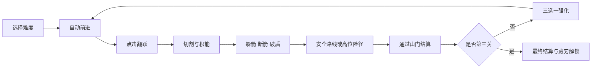
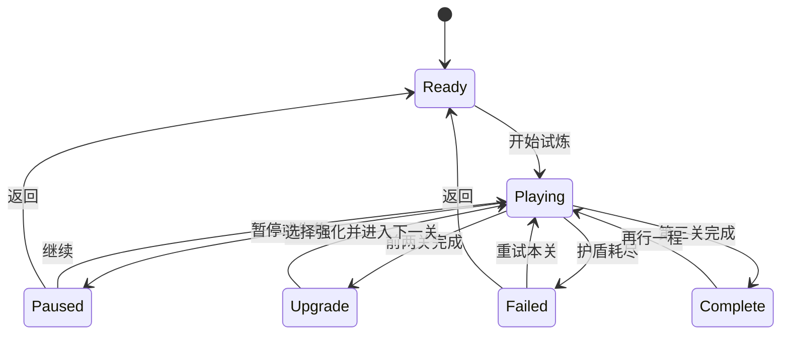

[English](game-design.md) | **简体中文**

# 飞刃行者游戏设计文档

项目英文名 Bladebound  
版本 0.2  
日期 2026 年 11 月 4 日  
项目类型 浏览器横向动作休闲游戏  
文档状态 可玩原型对应设计

## 阅读导航

- [产品定义](#1-产品定义)
- [核心循环与操作](#2-核心循环与操作)
- [战斗与资源](#3-战斗与资源)
- [关卡与内容](#4-关卡与内容)
- [强化与长期解锁](#5-强化与长期解锁)
- [状态与界面](#6-状态与界面)
- [数值总表](#7-数值总表)
- [美术与声音](#8-美术与声音)
- [技术与存档](#9-技术与存档)
- [验收与迭代](#10-验收与迭代)

## 1 产品定义

### 1.1 一句话定义

玩家操纵一把自动前进的飞刃，通过单次点击翻跃，在连续切割、躲箭和破盾之间安排时机，穿过三段山野路线，并在关间选择强化。

游戏的辨识点是切割与战斗共用一套输入和资源：切割物体积累能量，满能量后下一次命中敌人自动释放蓄能斩。水果排列、敌人位置与危险物共同决定玩家的行动顺序。

### 1.2 产品目标

| 项目 | 目标 |
| --- | --- |
| 平台 | 现代桌面与移动端浏览器 |
| 首要用户 | 偏好短局、低操作门槛、即时反馈的休闲动作玩家 |
| 单次完整流程 | 三关，通常约 2.5 至 4 分钟；重试和强化思考会延长 |
| 第一体验目标 | 一次有效按下产生清晰的翻跃，第一次切割立即反馈 |
| 核心熟练目标 | 连切积能，躲过攻击，再将蓄能斩用于持盾或重型目标 |
| 重复游玩动力 | 更高分、不同分路与强化搭配、外观解锁 |
| 主要输入 | 指针或触摸按下，键盘空格提供等价操作 |
| 首版付费与广告 | 无真实支付、无广告 SDK、无账号要求 |

当前时长为基于路径长度和速度的设计估计，尚不是玩家样本的实测中位数。

### 1.3 参考关系

| 参考游戏 | 吸收的设计思想 | 在飞刃行者中的调整 |
| --- | --- | --- |
| Slice Master | 单键翻刀、连续切割、向前推进 | 切割同时提供战斗能量，加入敌人与路线选择 |
| Space Waves | 障碍预告、按节奏调整轨迹、快速重试 | 统一为点击翻跃；普通失误使用护盾容错 |
| Ragdoll Archers | 弓箭威胁、命中物理反馈、成长决策 | 敌人自动射箭，玩家以刃口反击；成长以局内强化为主 |

本项目的代码、关卡、数值和 SVG 素材为独立原型内容。原作技术拆解文档保留在 ../crazygames，本项目不把其中的复现建议当成原作实值。

### 1.4 首版交付范围

| 系统 | 原型 0.2 |
| --- | --- |
| 核心移动与翻跃 | 已接入 Matter.js 固定步长物理 |
| 切割与连斩 | 已实现，物体只结算一次 |
| 蓄能斩、破盾、断箭 | 已实现 |
| 敌人 | 普通弓手、持盾弓手、重型弓手、一个首领 |
| 布娃娃 | 击败后生成关节刚体；活体采用固定姿态与攻击预告 |
| 内容 | 三关、12 个独立段落、每关一条高位分路 |
| 检查点 | 每关中段一盏行灯 |
| 局内强化 | 六种强化，两个关间选择节点 |
| 长期解锁 | 六种刀柄与尾迹配色，统一基础碰撞与移动参数 |
| 界面 | 标准与轻松难度、暂停、重试、结算、藏刃、行记、设置 |
| 保存 | 本地浏览器存档 |
| 语言 | 默认英语，支持英语与简体中文，开始界面和设置均可切换 |
| 后续扩展 | 更多关卡、完整活体物理、音源制作、平台 SDK 与玩家数据分析 |

## 2 核心循环与操作

### 2.1 单局循环



### 2.2 输入规则

| 输入 | 行为 |
| --- | --- |
| 游戏画面内按下鼠标或触摸 | 产生一次翻跃 |
| 操作栏翻跃按钮 | 相同的翻跃动作 |
| 空格按下 | 相同的翻跃动作，忽略键盘 repeat |
| P 或 Escape | 在运行和暂停之间切换 |
| 弹窗中的 Escape | 关闭当前弹窗 |
| 页面失去可见性或窗口焦点 | 自动暂停；后台测试手动时钟模式除外 |

输入按上升沿触发，按住不连发。最短有效间隔为 0.09 秒。空中允许再次翻跃，竖直速度重置为起跳速度，从而用点击节奏控制高度。

同一按钮同时承担移动和攻击决策：攻击由刃口接触触发，没有独立攻击键，也没有移动端虚拟摇杆。

### 2.3 移动模型

世界坐标采用浏览器画布习惯，x 向右、y 向下；长度单位为逻辑像素 px，时间单位为秒。屏幕缩放不改变世界单位或物理结果。

| 参数 | 值 |
| --- | --- |
| 标准前进速度 | 220 px/s |
| 轻松前进速度 | 188 px/s |
| 起跳竖直速度 | -610 px/s |
| 理论竖直加速度 | 约 1350 px/s²，来自 Matter.js gravity.y=1.35 |
| 翻跃后旋转速度 | 10.5 rad/s，持续 0.9 秒 |
| 常态旋转速度 | 1.65 rad/s |
| 最高位置 | 刀具中心 y 不小于 90 |
| 刀具物理尺寸 | 78 × 12 px |
| 主要地面高度 | y=492 |

一次自由起跳在无碰撞、无二次输入的理想模型下，顶点时间约为 0.452 秒，上升高度约为 137.8 px，返回同一高度约需 0.904 秒。标准速度下水平距离约为 198.8 px。刀具旋转与地面接触会影响实际轨迹，因此理论值只用于关卡初步验算。

原型采用旋转的矩形物理体。落地时刀身姿态会影响接触反馈，但不能改变前进速度的难度档位。刀具外观不调整这些基础运动参数。

### 2.4 镜头与适配

镜头跟随刀具横向位置，提供向前观察空间。桌面展示更宽的场景，移动端保持至少约 760 个逻辑单位的横向画幅，配合场景留白适配纵向屏幕。

刀具通常位于视野宽度约 20% 处，世界位置通过固定物理步长更新，画面由 requestAnimationFrame 绘制。窗口尺寸变化只调整投影比例和镜头位置，不重开关卡。

## 3 战斗与资源

### 3.1 资源

| 资源 | 来源 | 消耗或用途 | 保存范围 |
| --- | --- | --- | --- |
| 护盾 | 开始、关间恢复、青甲、归元 | 中箭、触棘和跌落 | 本次挑战 |
| 斩击能量 | 切割、断箭、聚刃 | 满能量命中敌人后清空 | 本次挑战，关间保留 |
| 分数 | 切割、击败、断箭、险径 | 不消耗；进入关卡金币换算 | 挑战内累计，最佳纪录永久 |
| 金币 | 每关完成后结算 | 解锁刀具配色 | 永久本地保存 |
| 连斩数 | 连续切割 | 超时或受伤中断 | 临时 |

### 3.2 切割

可切物包括红果、青梨和木箱。三类物体在原型中同价，差异主要体现为视觉、尺寸与碎片；后续可增设价值较高但更难接近的对象。

刃口使用上一帧、中间姿态和当前帧三次线段采样，对物体中心与半径做接触判断。命中后立即把 objectId 加入已消费集合，之后再播放碎片、音效、分数浮字和能量反馈。

同一个 objectId 在一次关卡尝试中只能结算一次。检查点回退时，检查点以后的临时收益和物体状态一并回退，避免重复切割获取永久货币。

### 3.3 连斩与得分

相邻两次切割间隔小于 1.6 秒时延续连斩，否则重新从 1 开始。受伤直接清空连斩。

```text
连斩倍率 = 1 + min(max(连斩数 - 1, 0), 4) × 0.25
单次切割得分 = round(10 × 连斩倍率 × (1 + 0.5 × 流光等级))
```

| 连斩数 | 无强化得分 | 流光 1 级 | 流光 2 级 |
| --- | --- | --- | --- |
| 1 | 10 | 15 | 20 |
| 2 | 13 | 19 | 25 |
| 3 | 15 | 23 | 30 |
| 4 | 18 | 26 | 35 |
| 5 及以上 | 20 | 30 | 40 |

JavaScript 的 Math.round 决定中间小数的取整方式，客户端显示和结算必须使用同一计算结果。

### 3.4 能量与蓄能斩

基础每次切割获得 16 点能量，聚刃每级额外 +8，上限 100。满能量只在有效命中敌人时消费，切割水果和触碰场景不会浪费蓄能斩。

```text
切割能量 = 16 + 8 × 聚刃等级
普通命中伤害 = 1
蓄能斩伤害 = 4
```

无强化时，连续切割 7 个物体达到满能量；聚刃 1 级需要 5 个，2 级需要 4 个。能量未满时直接造成普通伤害。

持盾敌人首先消耗 1 点伤害打破盾牌；剩余伤害继续作用于本体。普通命中会先破盾、下一次有效命中击败；蓄能斩可以同时破盾并击败本体。

### 3.5 断箭

箭与刃口接触判定通过时，箭立即销毁，获得 15 分和基础 4 点能量。折锋 1 级把收益改为 20 点，2 级为 25 点。

先判定刃口断箭，再判定箭是否接触刀具中心。断箭未成功且箭距刀具中心小于 21 px 时造成伤害。原型中这一设计提供可观察的断箭反馈，但自动旋转下的可控程度仍需玩家测试。

### 3.6 敌人

| 敌人 | 本体生命 | 盾牌 | 击败得分 | 攻击间隔 | 首次攻击延迟 |
| --- | --- | --- | --- | --- | --- |
| 普通弓手 | 1 | 无 | 100 | 2.3 秒 | 进入有效区域后 1.55 秒 |
| 持盾弓手 | 1 | 1 次伤害 | 150 | 2.3 秒 | 1.55 秒 |
| 重型弓手 | 2 | 无 | 180 | 3 秒 | 1.55 秒 |
| 守山人 | 6 | 无 | 600 | 1.1 秒 | 0.8 秒 |

只有位于刀具前方约 840 px 内、且没有被越过超过 70 px 的敌人才进入攻击调度。射击前约 0.5 秒显示瞄准虚线和警示，箭发射后不追踪玩家。

标准箭速为 310 px/s，轻松为 255 px/s；守山人额外乘以 1.1。箭由 Matter.js 计算运动，通过抵消部分重力得到约 81 px/s² 的下落加速度。发射时计算一次目标方向，避免持续追踪。

同一敌人的两次有效受击至少间隔 0.22 秒。该时间用于控制刀身连续接触造成的重复伤害，与 objectId 一次消费的水果规则不同。

### 3.7 首领战

守山人位于第三关最后一段 x=8870。进入首领前约 100 px 的接触区时，前进速度降至 65 px/s；接近首领 x-18 后停止前进，直到击败首领。翻跃仍保持原操作，允许在接触区躲箭并调整刃口姿态。

首领没有额外输入、独立瞄准或新的资源。玩家带入的能量和强化决定战斗效率：一次蓄能斩造成 4 点，仍需后续命中；普通斩需要累计 6 次有效命中。

首领被击败后恢复正常前进速度。第三关山门在首领仍存活时不能完成。当前是用于验证接触战斗的首领原型，尚未包含多阶段招式和完整活体布娃娃控制。

### 3.8 受伤与失败

| 情况 | 处理 |
| --- | --- |
| 中箭或触棘 | 护盾 -1，中断连斩，短暂受击反馈 |
| 普通受伤后 | 1.35 秒无敌时间 |
| 跌落，刀具中心 y>720 | 护盾 -1；仍存活则回到最近行灯 |
| 护盾降为 0 | 本次关卡失败，冻结物理并显示重试 |
| 重试本关 | 本关分数、目标与敌人重置，护盾恢复至上限，保留已选强化 |
| 已完成前关的金币 | 重试后保留；不会再次结算已完成的同一关卡事务 |

常规触棘不会把玩家强制送回检查点，保留向前推进。跌落必须回退位置，避免落入无地面区域后持续扣盾。

## 4 关卡与内容

### 4.1 关卡结构

每关由四个独立命名段落组成，每段长度 2400 px，总内容长度为 9600 px。刀具从 x=200 出发，山门完成触发位置为 x=9470，因此无停顿、无重试的基础推进距离为 9270 px。

| 关卡 | 内容主题 | 可切物 | 敌人 | 尖刺组 | 缺口 | 检查点 |
| --- | --- | --- | --- | --- | --- | --- |
| 竹影初行 | 切割反馈、初次险径、弓手与持盾 | 26 | 6 | 3 | 1 | x=4900 |
| 赤桥追风 | 尖刺组合、高位攻击与连续破盾 | 25 | 9 | 4 | 1 | x=4900 |
| 山门决意 | 已学机制组合与守山人 | 27 | 9，含首领 | 3 | 1 | x=4900 |
| 合计 | 12 个独立段落 | 78 | 24 | 10 | 3 | 3 个 |

所有排列当前为手工编排，重试使用同一关卡。首版不使用随机地形，以便评估操作窗口、检查点与难度变化。

### 4.2 十二个模块

| 关卡 | 段落与配置 ID | 世界 x 范围 | 主要目的 |
| --- | --- | --- | --- |
| 竹影初行 | 竹间拾光 grove | 0 至 2400 | 安全切割、积能与单个普通敌人 |
| 竹影初行 | 两径春色 orchard | 2400 至 4800 | 首次高位路线与下方危险物 |
| 竹影初行 | 桥头来箭 scout | 4800 至 7200 | 行灯、尖刺、缺口与弓箭预告 |
| 竹影初行 | 守桥之刃 guardian | 7200 至 9600 | 持盾目标与山门结算 |
| 赤桥追风 | 踏影越棘 teeth | 0 至 2400 | 两次间隔跳跃与重型目标 |
| 赤桥追风 | 赤桥分岔 windpath | 2400 至 4800 | 上层弓手与路线风险 |
| 赤桥追风 | 破甲回响 shieldline | 4800 至 7200 | 两次破盾与缺口控制 |
| 赤桥追风 | 风过赤桥 crossfire | 7200 至 9600 | 已学敌人类型组合 |
| 山门决意 | 山门问刃 redgate | 0 至 2400 | 持盾、弓手和重型的组合 |
| 山门决意 | 云间险径 cloudpath | 2400 至 4800 | 高位尖刺与重型守路 |
| 山门决意 | 箭雨之前 approach | 4800 至 7200 | 最后一次行灯后的综合操作 |
| 山门决意 | 最后的守山人 courtyard | 7200 至 9600 | 进入首领前补能，完成最终战斗 |

实际物体坐标、敌人种类、平台和缺口全部以 src/levels.js 为配置权威。修改内容优先修改该文件，再同步本节的总量表。

### 4.3 高位险径

每关第二段提供一条高位平台路线，主地面继续保留。上层布置额外切割目标，并在后续关卡加入尖刺或敌人，形成可选风险。

| 项目 | 当前值 |
| --- | --- |
| 高位平台 | 段内中心 x=1090，长度 960，高度 y=410 |
| 入口提示位置 | 段内约 x=630 |
| 路线判定位置 | 段内 x=1370 |
| 上层判定 | 刀具中心 y<408 |
| 通过奖励 | 分数 +150，完成本关后额外金币 +15 |
| 单次领取限制 | 以 routeId 去重 |

实际判定在经过判定 x 时执行一次，不按停留时长反复发奖。移动速度统一，玩家以提前翻跃进入上层路径。若选择下层则正常完成，不扣额外分数。

### 4.4 检查点

行灯位于第三模块开头 x=4900。通过后保存下列关卡尝试状态：

- 刀具恢复 x 位置。
- 当前累计分数、切割数、击败数和能量。
- 已切割 objectId、已击败 enemyId。
- 当前关卡已判断的分路，以及整次挑战已获的险径奖励。

恢复不返还已经扣掉的护盾，不回滚累计时间。尚未击败的敌人以模板生命重新建立，不保存部分受伤生命。跌落前、检查点之后获得的临时收益随对应对象一起回退。

检查点位置应在平地上，恢复后给予短暂无敌时间。原型恢复 y=450，地面下方没有尖刺，保留重新组织动作的空间。

### 4.5 内容制作约束

1. 必须在新危险物之前提供可观察的预告空间，敌人射击额外提供 0.5 秒瞄准预告。
2. 主路线上的所有缺口宽度不超过 110 px，低于单次标准起跳的理论水平覆盖距离。
3. 连续尖刺不能覆盖整个可达高度，空中再次翻跃可作为熟练操作，但首关不能依赖高频连按。
4. 高位路线具有独立危险，主路线保留可完成路径。
5. 山门之前不引入新规则，首领战之外不强制停住横向运动。
6. 装饰竹叶、远山、牌坊和桥栏不参与碰撞，实际危险物的色彩和轮廓需要清晰。

上述几何约束只能排除部分明显不可达布局。完整可达性仍需结合刀具旋转、接触与连续输入检查。

## 5 强化与长期解锁

### 5.1 关间强化

第一关、第二关完成后各出现一次三选一强化。一轮完整挑战一共选择两次，已有强化可以再次出现，最高 2 级。第三关完成后直接进入最终结算。

| 强化 | 1 级 | 2 级 | 主要方向 |
| --- | --- | --- | --- |
| 聚刃 energy | 切割能量由 16 改为 24 | 改为 32 | 更频繁的蓄能斩 |
| 回响 chain | 蓄能斩对 230 px 内其他敌人造成 2 点伤害 | 范围扩大至 320 px | 密集敌人清理 |
| 青甲 shield | 护盾上限 +1，立即恢复 1 | 再次上限 +1、恢复 1 | 增加容错 |
| 归元 leech | 每累计击败 3 名敌人恢复 1 格 | 每累计击败 2 名恢复 1 格 | 战斗续航 |
| 流光 combo | 切割得分额外 +50% | 额外 +100% | 高分与货币 |
| 折锋 parry | 每次断箭获得 20 能量 | 获得 25 能量 | 以反击补能 |

同一蓄能斩的回响不会递归产生新的回响，回响伤害可以打破盾牌，但不消耗另一份能量。回响仍通过敌人的唯一死亡流程结算，避免多重波及重复给分。

归元使用本轮累计击败数的整除节点触发。强化生效时不补发之前错过的治疗；不超出护盾上限。

关卡切换统一恢复 1 格护盾。若本次选择青甲，则先获得青甲提供的 1 格，再执行关间恢复，但两次都受新上限限制。

### 5.2 候选规则

原型采用可复现候选轮换：先过滤已满级项目，再按当前关卡和累计切割数计算起始位置，取三个不同强化。规则见 core.js 的 upgradeOptions。

这保证每次都有三个可选项，同时便于回归测试。正式版本可在玩家反馈后加入带权随机、避免连续重复和推荐协同组合，但目前没有隐含的抽取概率。

### 5.3 推荐搭配

| 搭配 | 体验 |
| --- | --- |
| 聚刃 + 回响 | 更频繁触发范围蓄能斩 |
| 青甲 + 归元 | 通过战斗恢复提高完成率 |
| 流光 + 聚刃 | 保持切割节奏，兼顾分数和战斗 |
| 折锋 + 聚刃 | 以断箭和切割两种方式积能 |

候选轮换不保证每一局都能形成指定搭配。它们是供观察的打法方向，不是已验证的强度排序。

### 5.4 金币结算

```text
本关基础金币 = floor((本关结束分数 - 本关开始分数) / 10)
本关总金币 = 本关基础金币 + 本关已获险径数量 × 15
```

切割、击败、断箭和险径分数都计入基础金币。险径的 +150 分还会产生 15 基础金币，再叠加 15 专属路线金币，合计带来 30 金币的增量。

例：本关获得 980 分且完成一条险径，则结算 98+15=113 金币。失败本关不结算该关临时收益，之前已完成关卡的金币保留。

结算事务使用 runId:stage 去重，钱包更新、已结算标识和累计统计在同一次保存中写入。重复点击、重复调用或同帧多个完成事件不会重复发放。

### 5.5 藏刃

| ID | 名称 | 价格 | 表现 |
| --- | --- | --- | --- |
| dawn | 初行 | 默认拥有 | 珊瑚色刀柄与暖色尾迹 |
| jade | 青竹 | 100 | 青绿色 |
| gold | 照野 | 160 | 金黄色 |
| frost | 听雪 | 220 | 冷青色 |
| rose | 落樱 | 300 | 粉红色 |
| ink | 墨客 | 400 | 墨绿色 |

总解锁价格为 1180 金币，不含默认刀具。外观不改变刀具长度、碰撞体、速度、跳跃、伤害与能量获得量。

购买前检查钱包，成功后同时扣币、记录拥有与选中外观。已经拥有的外观再次装备不扣币；金币不足的项目保持锁定。

首版没有永久战斗属性升级。这使前进与翻跃的肌肉记忆保持一致，也让初始玩家和已解锁全部外观的玩家使用相同关卡基础参数。

## 6 状态与界面

### 6.1 状态机



刀具、设置与行记弹窗是额外的 suspended 状态，不改写当前关卡状态。弹窗打开时停止物理，关闭后返回原状态；暂停画面不会因为关闭设置而误恢复运行。

### 6.2 首屏

首屏直接呈现游戏世界、刀具、可切物与操作区，叠加标题、语言、难度切换和开始按钮。没有单独宣传页，进入后即可开始试炼。

首次进入统一默认英语，不随设备语言自动改为中文。开始界面提供 English 与中文两个选项；设置中的语言菜单也可随时切换。所有菜单、关卡名、强化、结算、错误提示、图标提示与画布文字都使用同一份语言偏好，切换时不重置本局进度。

语言保存在现有存档的 language 字段，取值为 en 或 zh-CN。旧存档缺少该字段或字段无效时使用英语，保留原有金币、外观与纪录。主动选择中文后，刷新与后续访问继续使用中文。

难度只允许在 Ready 状态切换。标准提供 2 格基础护盾，轻松提供 4 格，轻松同步降低前进和敌方箭速。开始一轮后不会因设置变化切换难度。

### 6.3 HUD

| 位置 | 显示 |
| --- | --- |
| 顶部 | 品牌、三关进度、永久金币、刀具与纪录入口 |
| 场景上方 | 关卡名、难度、本关位置进度、分数与击败数 |
| 场景内部 | 当前段落名、对象状态、连斩、浮字、射击预告和行灯 |
| 场景下方 | 护盾、能量条、声音、暂停与翻跃按钮 |
| 底部 | 最高纪录与原型版本 |

手机隐藏非必要的章节导航和部分次要指标，保留护盾、能量、暂停和翻跃。按钮位置与尺寸稳定，不随得分位数或图标变化跳动。

### 6.4 失败与结算

失败显示失败原因、累计分数、切割与击败数量，提供返回与重试本关。重试会重置本关临时状态；它不自动重新开始整轮挑战。

关间显示本关金币和下一关名称，玩家必须选择一项强化才继续。最终结算显示得分、金币、击败、时间和切割数量，提供藏刃和新一轮挑战入口。

### 6.5 设置和可访问性

声音与减少动态效果使用二值开关，本地保存。减少动态效果关闭镜头抖动并减少切割粒子，系统 prefers-reduced-motion 同时关闭界面过渡。

图标按钮具有名称和悬停提示，所有交互控件保留可见焦点。弹窗使用 dialog 语义、键盘焦点循环与 Escape 关闭，背景控件在弹窗期间不可操作。

存档不可写时提示保存失败，当前会话仍可游玩。资源加载失败时显示重新载入入口，不让玩家停在空白画面。

## 7 数值总表

### 7.1 基础参数

| 分组 | 参数 | 当前值 | 权威配置 |
| --- | --- | --- | --- |
| 模拟 | 固定步长 | 1/120 秒 | config.js fixedStep |
| 移动 | 标准速度 | 220 px/s | difficulty.standard.speed |
| 移动 | 轻松速度 | 188 px/s | difficulty.relaxed.speed |
| 移动 | 起跳速度 | 610 px/s，方向向上 | jumpSpeed |
| 移动 | 最小输入间隔 | 0.09 秒 | minimumPressInterval |
| 资源 | 标准初始护盾 | 2 | difficulty.standard.shields |
| 资源 | 轻松初始护盾 | 4 | difficulty.relaxed.shields |
| 资源 | 能量上限 | 100 | fullEnergy |
| 资源 | 每次切割能量 | 16 | energyPerSlice |
| 战斗 | 普通与蓄能伤害 | 1 / 4 | baseDamage chargedDamage |
| 战斗 | 同敌人命中间隔 | 0.22 秒 | enemyContactCooldown |
| 战斗 | 受伤无敌时间 | 1.35 秒 | invulnerabilitySeconds |
| 连斩 | 延续间隔 | 小于 1.6 秒 | comboWindow |

### 7.2 收益

| 行为 | 分数 | 能量 | 额外金币 |
| --- | --- | --- | --- |
| 切割 | 基础 10，随连斩和流光变化 | 16，随聚刃变化 | 结算时按分数换算 |
| 普通弓手 | 100 | 0 | 同上 |
| 持盾弓手 | 150 | 0 | 同上 |
| 重型弓手 | 180 | 0 | 同上 |
| 守山人 | 600 | 0 | 同上 |
| 断箭 | 15 | 4，随折锋变化 | 同上 |
| 高位险径 | 150 | 0 | 完成本关后 +15 |

### 7.3 设计估算

仅考虑基础前进距离，标准关卡最低约 42.1 秒，轻松约 49.3 秒。第三关的首领减速与停留会增加时长，失败、回退和关间选择另计。

全部敌人基础得分合计为 3730。78 个可切物在无流光、最高连斩倍率下的理论上限为 1560 分，但真实物体间隔、路线取舍和连续输入会降低可取得量；不能把这个上界当成一局实际收入。

三条险径共增加 450 分与 45 专属金币。不能默认所有物体、所有敌人和每条险径都能在同一次挑战中无代价取得；实际可完成组合属于后续平衡验证项目。

### 7.4 首轮调优观察

| 指标 | 初始目标或观察方式 | 调整方向 |
| --- | --- | --- |
| 第一次切割出现时间 | 开始后约 2 至 4 秒 | 若太晚，前移首排目标 |
| 首次完整蓄能 | 第一关前两段内 | 调整物体数量或单次能量 |
| 首次失败位置 | 不应集中在第一处新机制前的盲区 | 增加预告或恢复空间 |
| 第一关完成率 | 先记录标准与轻松各自结果，再定目标 | 以敌人时序和障碍间距调节 |
| 高位路线选择率 | 观察是否能从奖励和布局理解风险 | 改善入口可读性和奖励位置 |
| 强化选择 | 观察是否有明显无人选择的项目 | 修改效果或关卡使用场景 |
| 首次外观解锁 | 预期 1 至数次有效关卡结算 | 调整价格和每关收入 |

这些为待验证假设。当前没有声称取得留存、完成率或广告收益样本。

## 8 美术与声音

### 8.1 视觉方向

采用清爽、低细节的山野插画风格。主场景由远山、竹林、桥梁、石道、行灯和山门组成；交互对象保持清楚的外轮廓与色彩对比。

| 对象 | 色彩与表现原则 |
| --- | --- |
| 可切物 | 红果、黄绿青梨、暖色木箱 |
| 飞刃 | 明亮冷色刃口，独立刀柄配色与尾迹 |
| 普通敌人 | 青绿色衣物与珊瑚色头盔 |
| 持盾敌人 | 左侧醒目的青绿盾牌，破盾时碎片与浮字 |
| 重型与首领 | 加大体型、暖色护甲，首领额外生命条 |
| 危险物 | 粉红至珊瑚色尖刺，与安全地面区分 |
| 奖励与蓄能 | 金黄色能量、行灯和险径标识 |
| UI | 浅色背景、深绿文字、有限的强调色 |

三关通过天空、山体、道路和桥栏调整环境，交互物的语义色不随主题反转。

### 8.2 素材清单

原型使用项目内原创 SVG 文件：brand、blade、fruit、pear、crate、archer 和 gate。所有资源本地加载，运行时不依赖远程图片服务。

切割表现使用同一素材的左右半片，交给两个 Matter.js 刚体运动。敌人击败后转为头、躯干、双臂和双腿六个刚体，并用五个约束连接。

活体敌人的当前姿态是固定的。完整的拉弓骨架动画、程序化平衡和受击姿态属于后续美术与物理工作，不能将当前原型描述为全活体物理战斗。

### 8.3 动效层级

1. 输入即时反馈为翻跃与旋转。
2. 普通切割使用半片、少量粒子与分数浮字。
3. 断箭使用金色碎片与短音。
4. 蓄能斩使用扩大斩光、金色轮廓和短暂镜头抖动。
5. 受伤使用短时屏幕暖色闪烁与刀具无敌闪烁。

粒子上限 180 个，切片刚体上限 48 个。切片约 2.8 秒后回收，布娃娃约 4 秒或离开镜头后回收。减少动态效果时降低粒子数量并关闭镜头抖动。

### 8.4 声音

原型通过 Web Audio 合成短音，区分翻跃、切割、普通命中、蓄能斩、断箭、受伤、射箭、升级和结算。只有用户交互后才创建音频上下文，声音开关永久保存。

正式版本建议制作独立音源，尤其是切割材质、刃口破盾、弓弦释放和山野环境声。当前没有长时间循环背景音乐，也没有外部音频授权依赖。

## 9 技术与存档

### 9.1 技术选型

| 层次 | 实现 |
| --- | --- |
| 工程与资源构建 | Vite，原生 ES Modules |
| 游戏渲染 | Canvas 2D |
| 物理 | Matter.js 0.20 系列 |
| UI | HTML CSS 原生 DOM |
| 图标 | Lucide |
| 音频 | Web Audio |
| 保存 | localStorage |
| 自动化 | Node test 与 Playwright 无界面浏览器 |

### 9.2 模块职责

| 文件 | 职责 |
| --- | --- |
| src/config.js | 基础参数、主题、强化和外观定义 |
| src/i18n.js | 中英文词条、占位参数与语言规范化 |
| src/levels.js | 12 个手工段落与场景构建 |
| src/core.js | 存档净化、经济事务、强化、检查点数据与基础几何 |
| src/world.js | 状态机、固定步长、碰撞、敌人、投射物与回收 |
| src/renderer.js | 场景绘制、素材、镜头与表现 |
| src/main.js | DOM 界面、输入、弹窗、设置和音效 |
| tests/core.test.mjs | 存档、货币、升级、检查点和关卡约束验证 |
| tests/browser.mjs | 真实页面中的输入、碰撞、状态转换、适配与渲染检查 |
| tests/playthrough.mjs | 轻松难度的连续三关输入脚本与流程记录 |
| tests/i18n.test.mjs | 默认语言、旧存档兼容、词条与参数覆盖 |
| tests/i18n.browser.mjs | 中英文切换、画布翻译、状态保持和长文本适配 |

### 9.3 物理与碰撞层

| 类别 | category | 碰撞规则 |
| --- | --- | --- |
| 地面与平台 | 1 | 作为静态可接触表面 |
| 切片和布娃娃 | 2 | 与地面碰撞，布娃娃同组部件不自碰撞 |
| 飞刃物理体 | 4 | 与地面和平台碰撞 |
| 箭 | 8 | 物理运动，接触由战斗判定处理 |

水果、敌人的可攻击范围与尖刺使用游戏逻辑的几何查询，避免把撞击冲量与游戏伤害绑定在一起。静态平台当前是实体平台，不是只允许从上方落下的单向平台。

### 9.4 保存结构

存档键为 bladebound.profile.v1。只保存永久进度和偏好，刷新页面不会恢复进行中的关卡。

```json
{
  "version": 1,
  "coins": 0,
  "bestScore": 0,
  "runs": 0,
  "clears": 0,
  "totalCuts": 0,
  "totalKills": 0,
  "owned": ["dawn"],
  "selected": "dawn",
  "sound": true,
  "language": "en",
  "reducedMotion": false,
  "difficulty": "standard",
  "settled": []
}
```

无效 JSON、未知版本、非法配色和非法难度回退到有效默认值；数值字段清理为非负有限整数。累计切割和击败只在完成关卡结算时写入，未完成关卡中的临时行为不计入永久统计。

存档没有联网防作弊保证。正式发布若涉及竞赛排行榜或支付，需要服务端校验与账号体系，当前没有这些接口。

### 9.5 运行与部署

开发运行使用 npm install 后 npm run dev -- --port 4173。生产构建使用 npm run build，产物在 dist，可部署到静态站点托管服务。

所有素材与依赖随构建打包；首次依赖安装需要网络，运行构建产物不需要访问素材 CDN。当前原型不包含平台广告、支付、云存档与遥测上报。

## 10 验收与迭代

### 10.1 功能验收

| 项目 | 通过条件 |
| --- | --- |
| 启动 | 首屏场景非空白，所有本地素材正常载入 |
| 输入 | 指针、触摸、空格均能产生翻跃，长按不触发键盘 repeat 连跳 |
| 切割 | 同一物体一次计分，碎片表现不再次计分 |
| 能量 | 满值不溢出，攻击敌人才消耗蓄能斩 |
| 盾牌 | 普通命中先破盾，蓄能可以继续伤害本体 |
| 断箭 | 刃口接触会销毁箭并结算一次 |
| 敌人 | 已死亡目标不继续射箭，死亡奖励只发一次 |
| 路线 | 高位判定只发一次奖励，回退对应回滚 |
| 检查点 | 跌落恢复位置与临时收益一致，不返还护盾 |
| 强化 | 两个关间节点都有三个可选项，选择后效果生效 |
| 首领 | 多次命中后击败，再通过最终山门 |
| 暂停 | 位置、伤害和敌人计时全部冻结 |
| 失败 | 停止运行，重试能进入有效状态 |
| 货币 | 相同结算 ID 不重复发钱，购买不能透支 |
| 保存 | 刷新后外观、金币和设置保留 |
| 语言 | 默认英语；中英文切换不重开关卡，刷新保留选择，画布与界面一致 |
| 适配 | 桌面、手机竖屏与横屏没有横向溢出，主要控件可用 |

### 10.2 测试边界

单元测试验证经济与状态契约，浏览器测试使用真实页面、真实输入绑定和真实物理碰撞。部分浏览器场景通过仅在开发模式 qa=1 下可用的控制接口设置初始位置和时间，以缩短回归等待。

这些受控碰撞与状态测试不等于真人完整通关，也不证明平衡、关卡完成率或长期留存已经达标。测试结果与截图保存在 test-results，发布构建不会包含可用的开发控制接口。

另有轻松难度连续流程脚本，使用固定时钟与键盘输入，从起点完成三关、关间选择及首领战，不使用传送或伤害、货币修改。其通过证明一条脚本路径能够完成，不覆盖所有路线与强化组合，也不能代替真人试玩。运行方式与验收结果见 [原型运行与验收](./acceptance.zh-CN.md)。

### 10.3 迭代顺序

| 阶段 | 目标 | 完成标准 |
| --- | --- | --- |
| 当前原型 | 三关核心循环可操作 | 核心状态、碰撞和存档通过验证 |
| 手感调优 | 降低不清楚的失败，强化主动操作 | 连续观察测试者的操作与失败原因 |
| 内容迭代 | 增加段落变化与路线选择 | 保持每次新机制有预告与安全学习空间 |
| 物理表现 | 完善活体动画与命中姿态 | 在目标设备帧率下保持关节稳定 |
| 平台集成 | 按平台要求接入 SDK | 广告、暂停、存档和奖励回调通过正式验收 |

### 10.4 本轮重点假设

第一，切割获得的能量能否让玩家主动寻找切割路线。第二，蓄能斩破盾是否足够可读。第三，空中重置竖直速度能否同时支持新手容错与熟练控制。第四，高位分路的收益能否抵消风险。第五，自动旋转对断箭与命中有多大影响。

后续应围绕这些问题调整速度、判定、敌人时序和物体排列，再扩展内容量。


